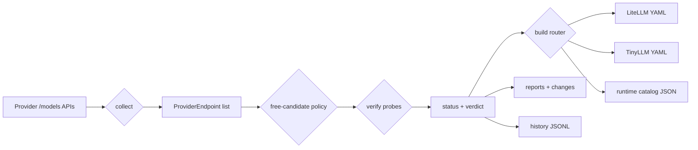

<p align="center">
  <picture>
    <source media="(prefers-color-scheme: dark)" srcset="https://img.shields.io/badge/status-active-2ea043?style=for-the-badge&logo=python&logoColor=white">
    
  </picture>
  
  
  
  
</p>

<h1 align="center">🆓 Free AI Model Router</h1>
<p align="center"><b>Daily ETL that collects models from provider APIs, classifies free access,<br>verifies reachability with real API calls, and generates ready-to-use routing configs.</b></p>

<p align="center">
  <a href="#features">Features</a> •
  <a href="#how-it-works">How It Works</a> •
  <a href="#quick-start">Quick Start</a> •
  <a href="#cli-reference">CLI Reference</a> •
  <a href="#free-access-policy">Free-Access Policy</a> •
  <a href="#output">Output</a> •
  <a href="#configuration">Configuration</a> •
  <a href="#providers">Providers</a> •
  <a href="#deployment">Deployment</a> •
  <a href="#architecture">Architecture</a> •
  <a href="#testing">Testing</a> •
  <a href="#known-gaps">Known Gaps</a>
</p>

---

## Problem

Dozens of LLM providers offer free tiers for coding models — OpenRouter, Groq, Gemini, Mistral, z.ai, OpenCode Zen, Cloudflare, DeepInfra, and many more. But:

- ❓ **Which models are free today?** Providers change pricing and free tiers constantly.
- ❓ **Are they actually reachable?** A model can be listed and still fail with 401, 402 or 429 for your account.
- ❓ **How do you keep a fallback chain fresh?** Free models appear and disappear; a router needs a chain that is regenerated, not hand-maintained.
- ❓ **How do you verify 20+ providers by hand?** You cannot, sustainably.

## Solution

**Free AI Model Router** is an automated ETL pipeline that answers these questions on every run:

1. **Collects** model lists from every enabled provider adapter
2. **Classifies** each endpoint as a free-access candidate using a side-effect-free policy (no network calls)
3. **Verifies** candidates with real `chat/completions` probes when an API key is present
4. **Filters** out endpoints that were probed and failed hard, keeping them in reports as evidence
5. **Generates** three routing artifacts: a LiteLLM proxy config, a TinyLLM dynamic routing config, and a machine-readable runtime catalog
6. **Reports** ranked tables, run-to-run changes, provider health, throttling, and per-model verdicts
7. **Persists** append-only verification history used for reliability statistics (success rate, p50/p95 latency)

Routing is **evidence-based, not score-based**: an endpoint enters the route when the free-access policy marks it route-eligible *and* it has not been proven unreachable at runtime. There is no benchmark-scoring or candidate-discovery stage in the current code (see [Known Gaps](#known-gaps)).

---

## Features

| | Capability | Detail |
|---|---|---|
| 🔍 | **Provider registry** | 23 providers in `config/providers.yaml`: 9 dedicated adapters + 10 through the generic OpenAI-compatible adapter |
| 🆓 | **Free-access policy** | `FreeStatus` + model-id markers (`:free`, `-free`) decide candidate and route eligibility |
| 🔐 | **Runtime verification** | Real generation probes, probe budgets, per-provider serialization, `Retry-After` cooldowns, 12-hour success reuse |
| 📊 | **Evidence, not exceptions** | Probe results become `VerificationStatus` + `AccessVerdict`; a 429 marks an endpoint as throttled instead of deleting it |
| ♻️ | **Provider-diverse route** | Route steps are built from routed endpoints across providers; duplicates are removed |
| 🧾 | **Three output formats** | LiteLLM YAML, TinyLLM dynamic YAML, JSON runtime catalog |
| 🕓 | **History & reliability** | Append-only JSONL evidence, percentiles, per-provider access history |
| 🔒 | **No secrets in artifacts** | Generated configs reference env var names only (`os.environ/...`, `api_key_env`) |
| 📅 | **Daily automation** | GitHub Actions at 05:17 UTC with `none` / `bounded` / `full` verification modes |
| 🐳 | **Docker-ready** | `python:3.12-slim` image, non-root user, `run-all` entrypoint |

---

## How It Works



### Pipeline stages

| Stage | Implementation | What happens |
|---|---|---|
| 1. Collect | `PipelineOrchestrator._collect_providers` | Each adapter fetches its model list, converts models to `ProviderEndpoint` + `CanonicalModel`, annotates free-candidate evidence. Provider errors are recorded per provider, not raised. |
| 2. Verify | `_verify_models` | Candidates are probed with a minimal generation request. Only endpoints whose provider has an API key are probed; recent successes (≤12 h) are reused from history. Per-probe timeout 20 s, one probe at a time per provider, `Retry-After` puts a provider on cooldown. |
| 3. History | `append_verification_history`, `append_provider_access_history` | Every probe and every model-list fetch is appended to JSONL evidence files. |
| 4. Build route | `_build_router` | Keeps endpoints that are route-eligible **and** not proven unroutable. |
| 5. Generate | `litellm_config`, `catalog`, `tinyllm_config` | Writes `output/litellm-config-sample.yaml`, `output/free-router-catalog.json`, `output/tinyllm-router-config.yaml`. |
| 6. Diff & report | `_detect_changes`, `generate_and_write_reports` | Compares with `output/latest.json`, writes change records and markdown reports. |
| 7. Persist | `save_router_output`, `save_pipeline_state` | Saves the new router output and the run state (success / partial / errors). |

### Routing rule

An endpoint is written into the routing outputs when both hold:

1. `free_candidate.route_eligible == true` — from `src/free_ai_model_router/policy/free_candidates.py`
2. It is **not** the case that `runtime_check.checked == true` and the status is unroutable

Routable probe statuses are `success`, `rate_limited` and `not_tested`. Consequences:

- An endpoint that was **never probed** (no API key, or skipped as a non-candidate) still enters the route, based on free-status evidence alone.
- An endpoint that answered `429` stays in the route and is reported as *exists but throttled*.
- Endpoints that answered `401` / `402` / `403` / `404` / `5xx` / timeout are removed from the route but stay visible in `reports/models.md` and `reports/throttled.md`.

---

## Quick Start

### Installation

```bash
pip install -e ".[dev]"
```

### Run the pipeline (needs at least one provider key)

```bash
# Any key following the <PROVIDER_ID>_API_KEY convention
export OPENROUTER_API_KEY="sk-or-..."
export GEMINI_API_KEY="AIza..."

# Full pipeline: collect → verify → generate → report
python -m free_ai_model_router run-all
```

### Verify one provider without spending quota elsewhere

```bash
python -m free_ai_model_router verify --provider groq
python -m free_ai_model_router verify --provider groq --max-probes 1
```

### Inspect local state without network calls

```bash
python -m free_ai_model_router providers
python -m free_ai_model_router model-verdicts --free-only
python -m free_ai_model_router free-candidates --provider openrouter
```

---

## CLI Reference

```bash
python -m free_ai_model_router <command> [options]
# or, after installation:
free-ai-model-router <command> [options]
```

| Command | Description |
|---|---|
| `run-all` | Full pipeline: collect → verify → generate → report |
| `collect` | Runs the pipeline with `no_runtime_checks=True` (collect + generate + report) |
| `generate` | Runs the pipeline with `no_runtime_checks=True` (same as `collect`) |
| `report` | Runs the pipeline with `no_runtime_checks=True` (same as `collect`) |
| `verify` | Full pipeline with runtime probes enabled. With `--provider <id>` the run is scoped to that provider and routing outputs are skipped (provider status reports only) |
| `providers` | Local provider/key/models-API status table, no network calls |
| `model-verdicts` | Latest per-model verification verdicts, no network calls |
| `free-candidates` | Free-candidate policy decisions per endpoint, no network calls |

**Global options**

| Flag | Description |
|---|---|
| `--log-level` | `DEBUG`, `INFO` (default), `WARNING` |
| `--base-dir` | Repository base directory; auto-detected by looking for a `config/` directory upward from the CWD |

**`verify` options**

| Flag | Description |
|---|---|
| `--provider <id>` | Restrict the run to one provider; defaults to 2 probes |
| `--max-probes <n>` | Cap the number of runtime probes |
| `--all-models` | Probe every model returned by the provider's `/models` API. Requires `--provider`, cannot be combined with `--max-probes`, and disables the free-candidate filter |
| `--free-candidates-only` / `--include-non-candidates` | Probe only policy-classified free candidates (default: on) |

**`run-all` options**

| Flag | Description |
|---|---|
| `--offline` | Skip provider collection entirely |
| `--no-runtime-checks` | Skip verification probes |
| `--use-cache` | Accepted for compatibility; currently not read by the pipeline |
| `--fail-on-stale` | Accepted for compatibility; currently not read by the pipeline |

**Report commands**

| Command | Options |
|---|---|
| `model-verdicts` | `--provider`, `--status <verification_status>`, `--free-only`, `--output <file.md>` |
| `free-candidates` | `--provider`, `--output <file.md>` |

---

## Free-Access Policy

Defined in `src/free_ai_model_router/policy/free_candidates.py`. The policy is pure: it only explains *why* an endpoint should be probed or routed.

| `FreeStatus` | Meaning | Candidate | Route-eligible |
|---|---|---|---|
| `verified_free` | Provider marks the model as free (e.g. `:free`) | ✅ | ✅ |
| `documented_free` | Provider documents a free tier (Groq, Gemini, Cloudflare) | ✅ | ✅ |
| `account_specific_free` | Free depends on the account / key (Mistral, z.ai, DeepInfra) | ✅ | ✅ |
| `temporary_free` | Time-limited free access | ✅ | ✅ |
| `trial_credit` | Trial credits available | ✅ | ❌ |
| `unknown` / `paid` / `unavailable` | No free evidence | ❌ | ❌ |

Independently of `free_status`, a model id containing `:free` or ending with `-free` is always treated as a candidate and route-eligible.

### Verification status and verdict

| `VerificationStatus` | `AccessVerdict` | Stays in route |
|---|---|---|
| `success` | `usable_now` | ✅ |
| `rate_limited` | `exists_but_throttled` | ✅ |
| `not_tested` | `unknown` | ✅ |
| `quota_exhausted` | `quota_exhausted_for_account` | ❌ |
| `client_restricted` | `not_accessible` | ❌ |
| `authentication_failed`, `model_not_found`, `region_blocked`, `provider_unavailable`, `timeout`, `invalid_response` | `not_accessible` | ❌ |

HTTP classification (`verification/status.py`), shared by every adapter:

| Response | Status |
|---|---|
| `200` | `success` |
| `401` | `authentication_failed` |
| `402` | `quota_exhausted` |
| `403` | `client_restricted` (provider-client markers) → `quota_exhausted` (balance/quota markers) → `region_blocked` → `authentication_failed` |
| `404` | `model_not_found` |
| `408`, `504` | `timeout` |
| `429` | `quota_exhausted` when the body mentions quota/balance, otherwise `rate_limited` |
| `5xx` | `provider_unavailable` |

`VerificationStatus.CLIENT_RESTRICTED` exists for free tiers that only work from the provider's own client (for example OpenCode Zen free-tier errors); such endpoints are recorded as evidence but never routed.

---

## Output

### `output/litellm-config-sample.yaml`

Generated by `generation/litellm_config.py`. Every routed endpoint becomes a `coding-auto-N` model entry with a comment block, and all entries are chained in `router_settings.fallbacks`:

```yaml
# LiteLLM Config Sample — Auto-generated by Free AI Model Router
# Generated at: 2026-09-27T12:15:11+00:00
model_list:
  # openrouter :: dots-studio/dots-3-note-preview:free
  #   Tools: yes
  #   Modality: text
  #   Free status: verified_free
  #   Free candidate: model_id_free_marker (model_id)
  - model_name: coding-auto-1
    litellm_params:
      model: openrouter/dots-studio/dots-3-note-preview:free
      api_base: https://openrouter.ai/api/v1
      api_key: os.environ/OPENROUTER_API_KEY
      timeout: 180

router_settings:
  fallbacks:
    - coding-auto:
        - coding-auto-1
        - coding-auto-2
  num_retries: 0
  cooldown_time: 300
  allowed_fails: 1
  enable_pre_call_checks: true

litellm_settings:
  drop_params: true
```

API keys are referenced as `os.environ/<PROVIDER_ID>_API_KEY`; no secret values are ever written.

### `output/tinyllm-router-config.yaml`

Generated by `generation/tinyllm_config.py` for a local TinyLLM proxy. It contains only `metadata`, `routing`, `timeouts`, `providers` and `routes`, so it can be layered over a static local config:

- `metadata.schema_version: 1` plus a `secrets_policy` note
- `routing` defaults: `cooldown_seconds: 300`, `max_attempts: 6`, `min_requests_for_trust: 20`, `min_success_rate: 0.5`, `max_empty_rate: 0.3`
- `timeouts`: `connect_seconds: 30`, `response_seconds: 120`, `stream_idle_seconds: 180`
- `providers`: only OpenAI-compatible bases without `{placeholder}` segments; headers are added for `openrouter` (`HTTP-Referer`, `X-Title`) and `opencode-zen` (`User-Agent`)
- `routes`: `agent-auto`, `coding-auto`, `agent-auto-pay`, `coding-auto-pay`, plus `coding-deepseek` when DeepSeek-family models are present
- Route steps are deduplicated, dynamic steps come first, then the statically configured `deepseek2api` steps, and the whole list is capped at `max_attempts`

### `output/free-router-catalog.json`

Machine-readable runtime catalog (`schema_version: 1`): one entry per routed endpoint with `litellm_model`, `api_base`, `free_status`, `free_candidate` evidence, `runtime_status`, `access_verdict`, models-API metadata, latency, retry-after, limits, tool calling, modalities, and aggregated `reliability` statistics.

### `output/latest.json`

The previous `RouterOutput`, used as the baseline for change detection on the next run. It is tracked in git, which is what makes the daily diff meaningful.

### Reports (`reports/`, git-ignored)

| File | Content |
|---|---|
| `models.md` | Routed endpoints table (provider, model, listed, verdict, probe, latency, retry-after, tools, limits) plus the endpoints excluded from routing |
| `changes.md` | Diff against the previous run: added, removed, verification-status changes |
| `provider-health.md` | Per-provider probe status counts |
| `throttled.md` | Rate-limited and quota-exhausted endpoints |
| `free-candidates.md` | Policy decision for every endpoint (candidate / route-eligible / reason) |
| `provider-access.md` | Key presence, models-API status, discovered model counts, historical runtime statuses |
| `history-summary.md` | Reliability metrics from verification history: success rate, p50/p95 latency |

### Local data (`data/`)

| Path | Content |
|---|---|
| `data/cache/*.json` | HTTP cache (git-ignored) |
| `data/history/verification.jsonl` | Append-only probe evidence (git-ignored) |
| `data/history/provider-access.jsonl` | Append-only models-API access evidence (git-ignored) |
| `data/pipeline-state.json` | Last run: run id, timings, success flags, errors |
| `data/normalized/*.json` | Committed model/endpoint snapshots (tracked; see [Known Gaps](#known-gaps)) |

---

## Configuration

All configuration lives in `config/` as YAML.

| File | Status | Purpose |
|---|---|---|
| `providers.yaml` | Active | Provider registry: `provider_id`, `api_base`, `api_style`, `adapter`, `discovery_priority`, `enabled`, `api_key_required`, `sources.*` |
| `manual-overrides.yaml` | Loaded, not applied | Parsed into `Settings.overrides`; no pipeline stage consumes it yet |
| `model-aliases.yaml` | Not read | Present as a placeholder for manual identity mappings |

**Adapter dispatch.** Adapters are selected by `provider_id` in `PipelineOrchestrator._init_adapters`, not by the `adapter:` field:

- `openrouter`, `opencode_zen`, `zai`, `groq`, `gemini`, `mistral`, `cerebras`, `cloudflare`, `deepinfra` → dedicated adapters
- any enabled provider with `api_style: openai_compatible` → `GenericOpenAICompatibleAdapter`
- any other API style (`cohere`, `anthropic`, …) → no adapter, the provider is skipped

**API keys.** The convention is `<PROVIDER_ID_UPPERCASE>_API_KEY`, read from the environment: `OPENROUTER_API_KEY`, `OPENCODE_ZEN_API_KEY`, `ZAI_API_KEY`, `GROQ_API_KEY`, `MISTRAL_API_KEY`, `CEREBRAS_API_KEY`, `CLOUDFLARE_API_KEY`, `DEEPINFRA_API_KEY`, `GEMINI_API_KEY`, `HUGGINGFACE_API_KEY`, `SAMBANOVA_API_KEY`, `TOGETHER_API_KEY`, `FIREWORKS_API_KEY`, `SILICONFLOW_API_KEY`, `NEBIUS_API_KEY`, `HYPERBOLIC_API_KEY`, `DEEPSEEK_API_KEY`, `OPENAI_API_KEY`, `ANTHROPIC_API_KEY`, `XAI_API_KEY`.

`CLOUDFLARE_ACCOUNT_ID` is additionally required by the Cloudflare adapter — without it, Cloudflare discovery is skipped with a warning.

**Shared HTTP client.** All adapters and collectors go through `http_client/client.py`:

- SSRF allow-list of provider domains, checked before every request
- up to 3 attempts with exponential backoff on timeout/connect errors (401/403/404 are not retried)
- `ETag` / `Last-Modified` conditional requests, plus a JSON disk cache (`data/cache/`) with a 2-hour default TTL and per-call overrides of 1–2 hours
- single user agent, 30-second default timeout

---

## Providers

`config/providers.yaml` defines 23 entries. "Collected" means the provider actually receives an adapter at runtime.

| Provider | `provider_id` | Adapter | Free-status rule | Collected |
|---|---|---|---|---|
| OpenRouter | `openrouter` | `openrouter` | `:free` in model id | ✅ |
| OpenCode Zen | `opencode_zen` | `opencode_zen` | `free: true` or `-free` suffix | ✅ |
| z.ai | `zai` | `zai` | every listed model → `account_specific_free` | ✅ |
| Groq | `groq` | `groq` | every chat model → `documented_free` | ✅ |
| Google Gemini | `gemini` | `gemini` | `generateContent` models → `documented_free` | ✅ |
| Mistral AI | `mistral` | `mistral` | every model → `account_specific_free` | ✅ |
| Cloudflare Workers AI | `cloudflare` | `cloudflare` | `@cf/` models → `documented_free` | ✅ |
| Cerebras | `cerebras` | `cerebras` | whitelist `gpt-oss-120b`, `gemma-4-31b`, `zai-glm-4.7` | ✅ |
| DeepInfra | `deepinfra` | `deepinfra` | catalog models → `account_specific_free` | ✅ |
| Hugging Face Inference | `huggingface` | generic | `:free` marker only | ✅ |
| SambaNova Cloud | `sambanova` | generic | `:free` marker only | ✅ |
| Together AI | `together` | generic | `:free` marker only | ✅ |
| Fireworks AI | `fireworks` | generic | `:free` marker only | ✅ |
| SiliconFlow | `siliconflow` | generic | `:free` marker only | ✅ |
| Nebius AI Studio | `nebius` | generic | `:free` marker only | ✅ |
| Hyperbolic | `hyperbolic` | generic | `:free` marker only | ✅ |
| DeepSeek | `deepseek` | generic | `:free` marker only | ✅ |
| OpenAI | `openai` | generic | `:free` marker only | ✅ |
| xAI | `xai` | generic | `:free` marker only | ✅ |
| Cohere | `cohere` | — (`api_style: cohere`) | — | ❌ |
| Anthropic | `anthropic` | — (`api_style: anthropic`) | — | ❌ |
| GitHub Models | `github_models` | — | `enabled: false` (service retired) | ❌ |
| Replicate | `replicate` | — | `enabled: false` (native predictions API) | ❌ |

Providers whose model lists carry no free evidence at all (DeepSeek, OpenAI, Anthropic, xAI, …) are still collected for monitoring, but none of their models reach a route until a free tier appears or a model id carries a free marker.

---

## Deployment

### Docker

```bash
docker build -t free-ai-model-router .

docker run --env-file .env \
  -v "$(pwd)/data:/app/data" \
  -v "$(pwd)/output:/app/output" \
  -v "$(pwd)/reports:/app/reports" \
  free-ai-model-router
```

The image runs as a non-root user and its default command is `python -m free_ai_model_router run-all` (runtime verification enabled).

### Docker Compose

```yaml
services:
  model-router:
    build: .
    env_file: .env
    volumes:
      - ./data:/app/data
      - ./output:/app/output
      - ./reports:/app/reports
    restart: "no"
```

### GitHub Actions

**`ci.yml`** — on pushes to `master` touching `config/`, `src/`, `tests/`, workflows, `pyproject.toml`, `output/latest.json` or `data/normalized/endpoints.json`, and on pull requests:

1. `pytest`
2. `ruff check --select E,F,I src tests`
3. Smoke-generate the TinyLLM config from `output/latest.json` + `data/normalized/endpoints.json` into `artifacts/` and assert it contains `deepseek2api` and a non-empty `coding-auto` route

**`daily-update.yml`** — every day at 05:17 UTC and on manual dispatch:

1. Install dependencies
2. `run-all --no-runtime-checks` (collect + generate + report)
3. `verify` according to the dispatch input `verification_mode`: `none` (skip), `bounded` (`--max-probes`, default 20), `full` (no probe cap; the free-candidate filter still applies)
4. Build `action-reports/` (reports, catalog, LiteLLM + TinyLLM configs, provider status, free candidates, free model verdicts) and upload it as an artifact with 3-day retention
5. Commit and push `output/` only when the generated artifacts actually changed
6. Write a job summary

Concurrency is limited to one `daily-model-update` run, permissions are `contents: write` only, and the job has a 30-minute timeout.

---

## Architecture

```
free-ai-model-router/
│
├── config/
│   ├── providers.yaml               # 23 provider definitions
│   ├── model-aliases.yaml           # placeholder (not read yet)
│   └── manual-overrides.yaml        # parsed into Settings, not applied yet
│
├── src/free_ai_model_router/
│   ├── models.py                    # Pydantic v2 models + all enums
│   ├── cli.py                       # Click CLI (8 commands)
│   ├── config_loader.py             # YAML → typed configs, Settings, env keys
│   │
│   ├── http_client/client.py        # Retry, ETag cache, SSRF allow-list
│   ├── storage/
│   │   ├── cache.py                 # TTL JSON cache
│   │   └── state.py                 # Normalized data, history, router output, run state
│   │
│   ├── pipeline/orchestrator.py     # Full run coordination (collect→verify→generate→report)
│   │
│   ├── providers/
│   │   ├── base.py                  # ProviderAdapter protocol, ProviderModel, VerificationResult
│   │   ├── openai_compatible.py     # Generic adapter for standard /models + /chat/completions
│   │   ├── openrouter.py  opencode_zen.py  zai.py  groq.py
│   │   ├── gemini.py  mistral.py  cerebras.py  cloudflare.py  deepinfra.py
│   │
│   ├── policy/free_candidates.py    # Free-access candidate policy (pure functions)
│   ├── verification/status.py       # HTTP → status, status → verdict, Retry-After parsing
│   │
│   └── generation/
│       ├── litellm_config.py        # LiteLLM proxy YAML with fallback chain
│       ├── tinyllm_config.py        # TinyLLM dynamic routing YAML
│       ├── catalog.py               # Runtime catalog JSON
│       └── reports.py               # All markdown reports
│
├── tests/                           # 70 tests (pytest, asyncio_mode=auto)
├── output/                          # Generated artifacts (tracked)
├── reports/                         # Generated reports (git-ignored)
├── data/                            # cache, history, normalized snapshots, run state
│
├── Dockerfile
├── .github/workflows/ci.yml
├── .github/workflows/daily-update.yml
└── pyproject.toml
```

### Key design decisions

- **Pydantic v2 at every boundary**: provider responses, normalized endpoints, history records, and generated configs all pass through validated models.
- **Failures are data, not exceptions**: a provider outage becomes a typed `VerificationStatus` / provider error entry; the run still completes and reports it.
- **Shared HTTP infrastructure**: retries, conditional caching, and SSRF protection exist once, in `HttpClient`.
- **Adapters are duck-typed protocols**: no shared base class; dispatch is an explicit `provider_id → class` map.
- **Separated policy and network**: `policy/free_candidates.py` has no I/O, so routing decisions are testable and explainable.
- **Evidence history**: every probe is appended to JSONL, which enables reliability statistics without a database.
- **Secrets stay in the environment**: generated artifacts reference env var names only.

---

## Testing

```bash
pytest                                   # 70 tests
pytest tests/test_tinyllm_config.py -v   # single file
ruff check --select E,F,I src tests      # lint (CI selection)
```

| Test file | Tests | Covers |
|---|---:|---|
| `test_providers.py` | 23 | Cerebras, Cloudflare, DeepInfra and generic adapters: discovery, filtering, endpoints, verification |
| `test_reports.py` | 13 | Every markdown report generator |
| `test_storage.py` | 6 | History append/load, verification stats |
| `test_tinyllm_config.py` | 6 | TinyLLM YAML sections, secret-free output, route caps, static steps |
| `test_verification.py` | 6 | Status classification, verdicts, retry-after parsing |
| `test_orchestrator.py` | 5 | Adapter selection, provider filtering, candidate-only verification |
| `test_free_candidates.py` | 4 | Free-access policy decisions |
| `test_models.py` | 4 | Model defaults and enums |
| `test_generation.py` | 2 | LiteLLM config generation |
| `test_catalog.py` | 1 | Runtime catalog metadata |

`pyproject.toml` also configures strict `mypy` and a wider Ruff rule set (`E`, `F`, `I`, `N`, `W`, `UP`); CI currently runs tests and `E,F,I` lint only.

---

## Known Gaps

Documented behaviour that differs from what the code once did, or that is still rough:

- **No benchmark scoring or model discovery.** Models come exclusively from provider `/models` APIs and the free-access policy. The local (git-ignored) Russian requirements file still describes the earlier Artificial-Analysis-scoring design.
- **`data/normalized/*.json` are frozen snapshots.** `save_normalized_data()` exists but is never called, while `providers`, `model-verdicts` and `free-candidates` read those files — their model lists can lag behind the latest run (verification history they use is current).
- **Unused config:** `config/model-aliases.yaml` is never read; `config/manual-overrides.yaml` is loaded into `Settings.overrides` but never applied.
- **No-op flags:** `run-all --use-cache` and `--fail-on-stale` are accepted but not read by the pipeline; `generate --output-dir` is accepted but ignored.
- **`adapter:` in `providers.yaml` is informational.** Dispatch is by `provider_id`, which is why `huggingface` (declared with `adapter: huggingface`) actually runs on the generic adapter.
- **Two enabled providers have no adapter:** `cohere` and `anthropic` use non-OpenAI API styles, so they are silently skipped during collection.
- **TinyLLM output is partly hardcoded:** the `deepseek2api` provider and its two model steps are always injected, and both `*-pay` routes currently mirror their free counterparts.
- **`ARTIFICIAL_ANALYSIS_API_KEY`** is still passed by the daily workflow although no code reads it.
- **Report language is mixed:** `models.md` and `changes.md` are generated in Russian, the other reports in English.

---

## Contributing

Contributions are welcome:

- Add adapters for new free providers (YAML entry + adapter class + `_init_adapters` mapping)
- Improve the free-access policy heuristics
- Extend the TinyLLM dynamic-config contract with the proxy project
- Add LiteLLM integration tests (actual proxy spin-up)
- Resolve the gaps listed above

## License

MIT © 2026 [sstpnk](https://github.com/sstpnk)

---

<p align="center">
  <sub>Built with ❤️ for the open-source AI community · No API keys were harmed in the making</sub>
</p>
